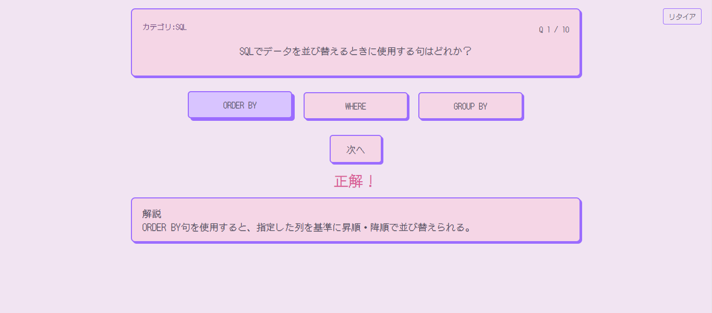
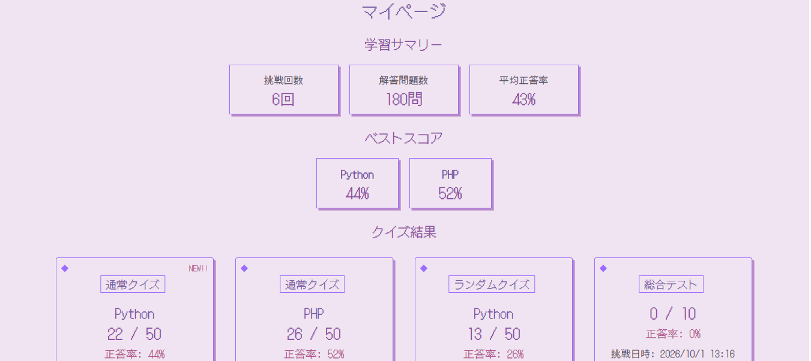

# ProQuiz
 
## 概要
 
ProQuizは、プログラミングやITに関する知識をクイズ形式で学習できるWebアプリです。
 
Python・PHP・SQL・Git・Dockerの5カテゴリに対応しており、通常クイズ、ランダムクイズ、総合テストから学習方法を選択できます。
 
ユーザー登録・ログイン機能やクイズ結果の保存、マイページでの学習履歴確認にも対応しています。
 
## 主な機能
 
* ユーザー登録・ログイン・ログアウト
* Python・PHP・SQL・Git・Dockerの5カテゴリ
* 通常クイズ
* ランダムクイズ
* 総合テスト（ランダム10問）
* 3択形式のクイズ
* 回答後の解説表示
* クイズ結果の保存
* 回答履歴の保存
* マイページでのクイズ結果・学習履歴の確認
* カテゴリ別のベストスコア表示
## 使用技術
 
| 分類      | 技術                                |
| ------- | --------------------------------- |
| フロントエンド | React / Vite                      |
| バックエンド  | Laravel / PHP                     |
| データベース  | MySQL                             |
| 認証      | Laravel Fortify / Laravel Sanctum |
| CI      | GitHub Actions                    |
| 開発環境    | Docker / XAMPP                    |
| バージョン管理 | Git / GitHub                      |
 
## 画面
 
### クイズ開始画面
 

 
### クイズ画面
 

 
### マイページ
 

 
## 工夫した点
 
* ユーザーごとにクイズ結果・回答履歴を保存可能に
* 学習履歴を確認できるようにマイページを実装
* カテゴリ別ベストスコアを表示
* ReactとLaravelを分けてAPIで通信
* Laravel Fortify / Sanctumを使用した認証
* クイズ問題・選択肢をSeederで管理
* 楽しく勉強できるようにレトロポップをイメージしたデザインに
* Dockerを利用してバックエンドの実行環境を構築
* Docker Composeで、コードの変更がコンテナにすぐ反映される開発環境に
## テスト
 
各カテゴリ・各クイズモードを実際に操作し、クイズの出題・回答・結果保存・マイページへの反映などの動作を確認しました。
 
また、GitHubからリポジトリを新しくcloneし、Dockerを使用した環境でもバックエンドAPIとクイズが正常に動作することを確認しています。
 
## セットアップ
 
### 必要な環境
 
* PHP 8.5.7
* Composer 2.10.1
* Laravel 13.17.0
* Node.js 24.18.0
* npm 11.16.0
* MySQL
* Docker Desktop
### 1. リポジトリを取得
 
```bash
git clone https://github.com/rjypojp/ProQuiz.git
 
cd ProQuiz
```
 
### 2. MySQLの準備
 
MySQLを起動し、`proquiz` データベースを作成します。
 
XAMPPを使用する場合は、XAMPPのMySQLを起動してください。
 
データベース名：
 
```text
proquiz
```
 
### 3. Backendのセットアップ
 
`.env` を作成し、Dockerコンテナを起動します。
 
```bash
cd backend
 
cp .env.example .env
# PowerShellの場合: copy .env.example .env
 
docker compose up -d --build
```
 
アプリケーションキーを生成します。
 
```bash
docker compose exec backend php artisan key:generate
```
 
BackendはDockerコンテナ上で `http://localhost:8081` で動作します。
 
### 4. Laravelの環境設定
 
`backend/.env` のデータベース設定を以下のようにします。
 
```env
DB_CONNECTION=mysql
DB_HOST=127.0.0.1
DB_PORT=3306
DB_DATABASE=proquiz
DB_USERNAME=root
DB_PASSWORD=
```
 
Docker上では、`docker-compose.yml` の設定で `DB_HOST` が `host.docker.internal` に上書きされ、コンテナからホストOS上のMySQLへ接続します。
 
また、ReactからのCookie認証（Laravel Sanctum）のため、`SANCTUM_STATEFUL_DOMAINS=localhost:5173` も同じ `docker-compose.yml` で指定しています。
 
### 5. データベースのセットアップ
 
マイグレーションとSeederを実行します。
 
```bash
docker compose exec backend php artisan migrate --seed
```
 
### 6. Frontendのセットアップ
 
別のターミナルを開き、フロントエンドを起動します。
 
```bash
cd frontend
 
npm install
 
npm run dev
```
 
### 7. アプリにアクセス
 
ブラウザで以下を開きます。
 
```text
http://localhost:5173
```
 
## 日常の使い方
 
パソコンの再起動やDocker Desktopの終了のあとは、コンテナが止まっています。`backend` フォルダで以下を実行してください。
 
```bash
docker compose up -d
```
 
停止するときは以下です。
 
```bash
docker compose stop
```
 
## トラブルシューティング
 
### ログインボタンを押しても何も起きない / ERR_CONNECTION_REFUSED
 
Backendのコンテナが止まっています。Docker Desktopを起動してから、`backend` フォルダで `docker compose up -d` を実行してください。
 
### ログインしてもすぐログアウトされる / `/api/user` が401になる
 
`SANCTUM_STATEFUL_DOMAINS` がコンテナに渡っていない可能性があります。`docker-compose.yml` の `environment` に `SANCTUM_STATEFUL_DOMAINS: localhost:5173` があることを確認し、`docker compose up -d --force-recreate` で作り直してください。
 
### Laravelのエラー `Class "Laravel\Pail\PailServiceProvider" not found`
 
Windows側で `composer install` などを実行すると、`bootstrap/cache` に開発用パッケージ入りのリストが作られ、コンテナ側のvendorと食い違うことがあります。以下で作り直してください。
 
```bash
docker compose exec backend sh -c "rm -f bootstrap/cache/packages.php bootstrap/cache/services.php"
docker compose exec backend php artisan package:discover